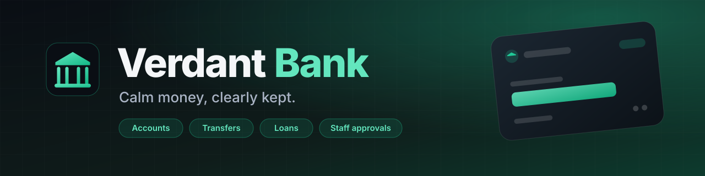
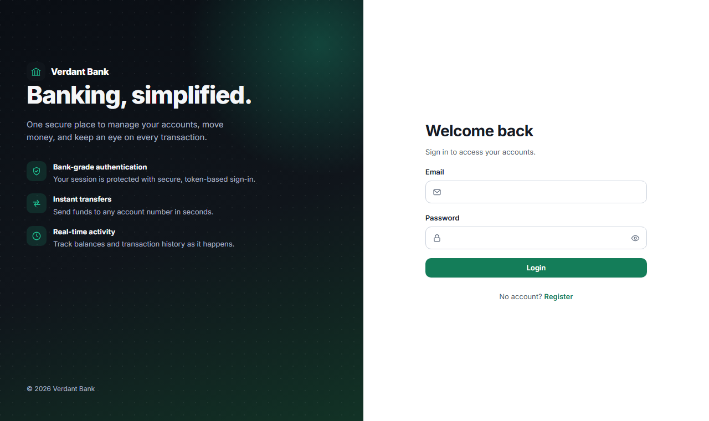
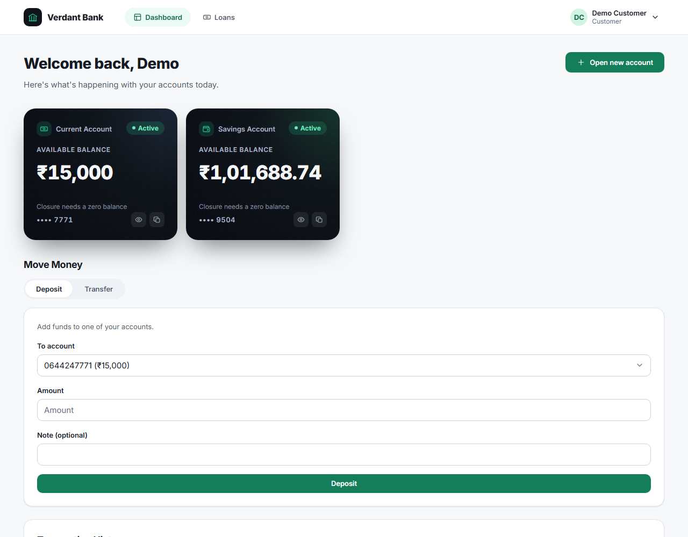
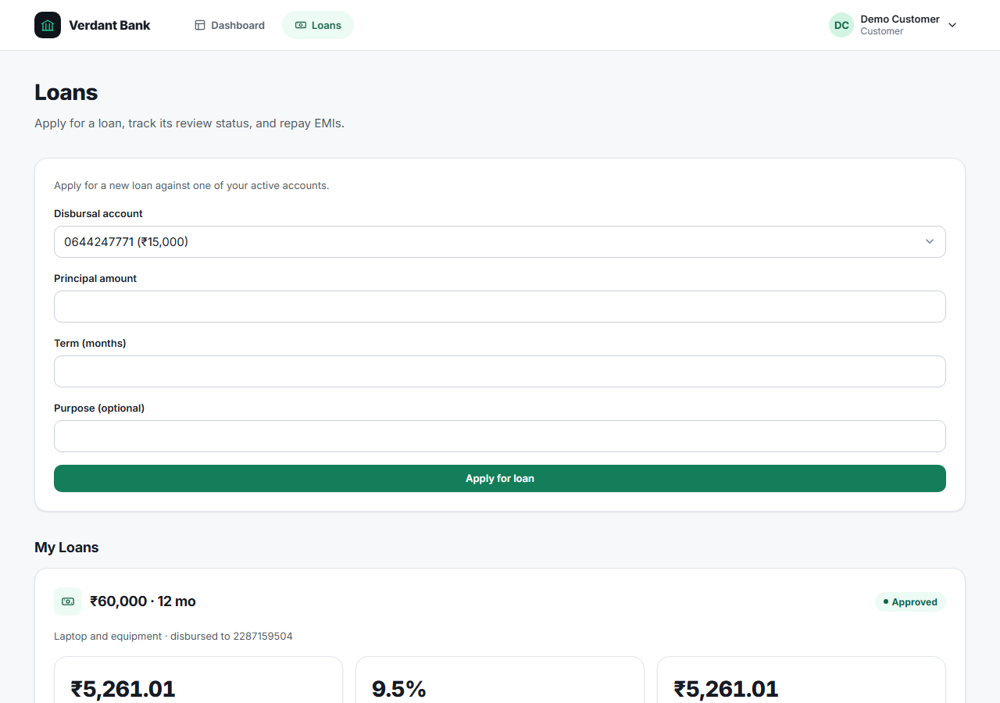
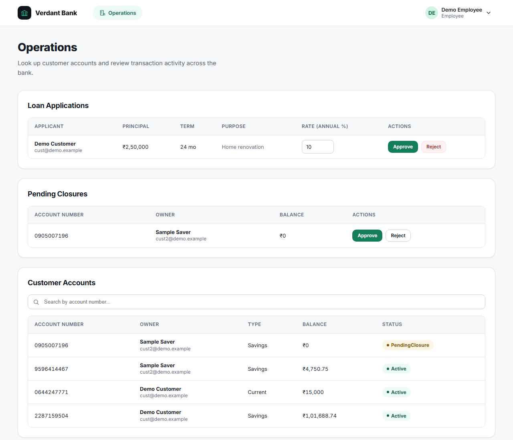
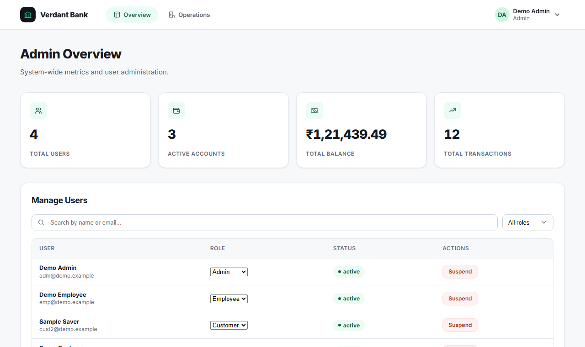
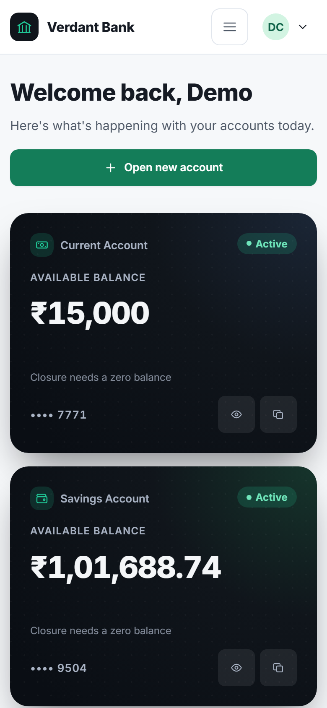
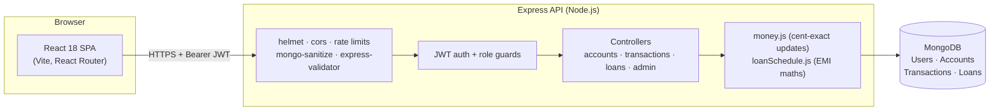
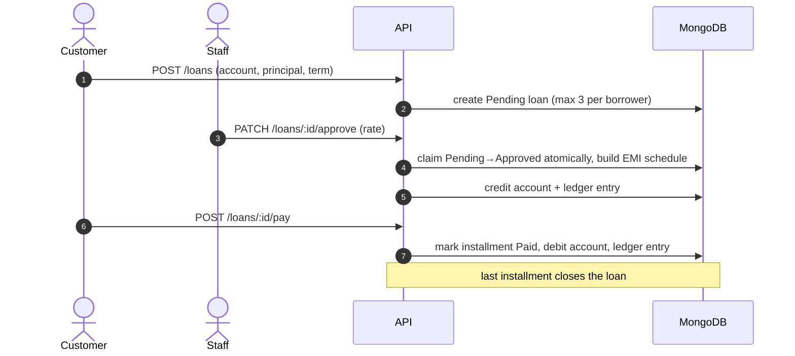

<div align="center">



<br/>


# Verdant Bank

**Calm money, clearly kept.**

A full-stack banking app: accounts, instant transfers, loans with real EMI schedules, and role-based dashboards for customers, staff and admins.

[](https://github.com/Slv-WebTech/banking-management/actions/workflows/ci.yml)


[Features](#-features) · [Screenshots](#-screenshots) · [Architecture](#-architecture) · [Quick start](#-quick-start) · [API](#-api-overview) · [Testing](#-testing) · [Security](#-security) · [Roadmap](#-roadmap)

</div>

---

## ✨ Features

<table>
  <tr>
    <td width="33%" valign="top">
      <h4>🔐 Secure access</h4>
      JWT sessions, bcrypt hashing, three roles (<code>customer</code>, <code>employee</code>, <code>admin</code>), live role/suspension checks on every request.
    </td>
    <td width="33%" valign="top">
      <h4>🏦 Accounts</h4>
      Open Savings or Current accounts, reveal/copy account numbers, and request closure yourself. Staff approve or reject from a queue.
    </td>
    <td width="33%" valign="top">
      <h4>💸 Money movement</h4>
      Deposits and account-to-account transfers with atomic balance updates, cent-exact arithmetic and race-safe idempotency keys.
    </td>
  </tr>
  <tr>
    <td valign="top">
      <h4>🧾 History &amp; search</h4>
      Paginated, filterable history; search by reference, note or counterparty account number; debounced and injection-safe.
    </td>
    <td valign="top">
      <h4>📈 Loans</h4>
      Apply → staff review (sets the rate) → disbursal → reducing-balance EMI schedule → repayment → auto-close.
    </td>
    <td valign="top">
      <h4>🛠 Admin tools</h4>
      User search, role changes, suspend/activate, and a system report. Self-demotion and self-suspension are blocked.
    </td>
  </tr>
  <tr>
    <td valign="top">
      <h4>📱 Responsive &amp; accessible</h4>
      Works from 375&nbsp;px up; skip link, labelled controls, WCAG AA contrast, 44&nbsp;px touch targets on small screens.
    </td>
    <td valign="top">
      <h4>⚡ Fast</h4>
      Indexed queries, paginated staff lists, debounced search and code-split role screens (main bundle ≈ 81&nbsp;kB gzipped).
    </td>
    <td valign="top">
      <h4>✅ Tested</h4>
      108 server and 28 client automated tests, CI on every PR, and a documented live QA pass across all three roles.
    </td>
  </tr>
</table>

## 📸 Screenshots

All screenshots use fictional demo data.

<div align="center">

| Sign in | Customer dashboard |
|:---:|:---:|
|  |  |

| Loans | Staff operations |
|:---:|:---:|
|  |  |

| Admin overview | Mobile |
|:---:|:---:|
|  |  |

</div>

## 🧭 Architecture





Money moves are single-document atomic updates with compensating writes (no multi-document transactions yet); every balance change rounds to cents inside the database. See [`docs/ARCHITECTURE.md`](docs/ARCHITECTURE.md) and [`docs/DECISIONS.md`](docs/DECISIONS.md).

## 🚀 Quick start

**Prerequisites:** Node.js 18+, and a MongoDB (local `mongod` or an Atlas connection string).

```bash
# 1. API
cd server
npm install
cp .env.example .env        # then set MONGO_URI and a long random JWT_SECRET
npm run dev                 # http://localhost:5000

# 2. Web app (new terminal)
cd client
npm install
cp .env.example .env        # VITE_API_URL defaults to http://localhost:5000/api
npm run dev                 # http://localhost:5173
```

Register a customer in the UI, then promote the first admin (employees can be promoted from the admin screen):

```bash
cd server
npm run seed:admin -- you@example.com
```

> The server refuses to start with a short or placeholder `JWT_SECRET`. Generate one with
> `node -e "console.log(require('crypto').randomBytes(48).toString('hex'))"`.

### Environment variables

| Variable | Where | Default | Purpose |
|---|---|---|---|
| `PORT` | server | `5000` | API port |
| `NODE_ENV` | server | — | Use `production` when deployed (hides stack traces / 5xx details) |
| `MONGO_URI` | server | `mongodb://127.0.0.1:27017/banking-management` | MongoDB connection string |
| `JWT_SECRET` | server | *(none — required)* | ≥ 32 random characters; placeholders are rejected |
| `JWT_EXPIRES_IN` | server | `7d` | Token lifetime |
| `CLIENT_URL` | server | `http://localhost:5173` | CORS allow-listed origin |
| `MAX_DEPOSIT_AMOUNT` | server | `100000` | Per-request deposit cap |
| `MAX_TRANSACTION_AMOUNT` | server | `10000000` | Per-request transfer/loan cap |
| `MAX_PENDING_LOANS` | server | `3` | Pending applications allowed per borrower |
| `TRUST_PROXY` | server | unset | Set to `1` behind a reverse proxy |
| `VITE_API_URL` | client | `http://localhost:5000/api` | API base URL |

Only `.env.example` files are tracked; real `.env` files are git-ignored.

## 🔌 API overview

All routes are under `/api` and return JSON. Protected routes need `Authorization: Bearer <jwt>`. Full reference: [`docs/API_DOCUMENTATION.md`](docs/API_DOCUMENTATION.md).

| Area | Endpoints | Access |
|---|---|---|
| Auth | `POST /auth/register` · `POST /auth/login` · `GET /auth/me` | public / any user |
| Accounts | `POST /accounts` · `GET /accounts/mine` · `GET /accounts/:id` · `POST /accounts/:id/request-closure` | customer (owner) |
| Account staff | `GET /accounts/all` · `POST /accounts/:id/approve-closure` · `…/reject-closure` | employee, admin |
| Money | `POST /transactions/deposit` · `POST /transactions/transfer` · `GET /transactions/mine` | customer |
| Ledger (staff) | `GET /transactions/all` | employee, admin |
| Loans | `POST /loans` · `GET /loans/mine` · `GET /loans/:id` · `POST /loans/:id/pay` | customer |
| Loan review | `GET /loans/all` · `PATCH /loans/:id/approve` · `PATCH /loans/:id/reject` | employee, admin |
| Admin | `GET /admin/users` · `PATCH /admin/users/:id/status` · `PATCH /admin/users/:id/role` · `GET /admin/report` | admin |
| Health | `GET /health` | public |

List endpoints for staff accept `?page` / `?limit` and return the total in the `X-Total-Count` header.

## 🧪 Testing

```bash
cd server && npm test     # Jest + Supertest + in-memory MongoDB — 108 tests
cd client && npm test     # Vitest + React Testing Library — 28 tests
cd client && npm run build
```

CI ([`.github/workflows/ci.yml`](.github/workflows/ci.yml)) runs both suites and the production build on every pull request. A senior-QA pass on 2026-11-20 additionally exercised every flow live in Chrome, ran a 76-check black-box API battery and measured performance at 60k transactions; the full findings are in [`docs/QA-REPORT.md`](docs/QA-REPORT.md).

## 🛡 Security

- Passwords hashed with bcrypt (8–72 characters); login is timing-equalised so unknown emails can't be enumerated.
- JWT checked against the live database on every request — suspension and role changes apply immediately.
- `helmet` headers, strict CORS, body-size cap, NoSQL-operator stripping, escaped regex search, validated ids and typed fields (bad input is a 400, never a 500).
- Per-user rate limits on money-moving routes; per-IP limits on login/register.
- Amounts are validated to 2 decimals with caps; balance updates are atomic and rounded to cents in the database.
- Self-approval blocked on loans and account closures; admins can't change their own role or status.
- Stack traces are returned only when `NODE_ENV=development`.

Found a vulnerability? Please don't post exploit details in a public issue — open an issue asking for a private contact and the maintainer will follow up.

## ⚠️ Known limitations

- **Self-service deposits create money** (there is no funding source) — a deliberate demo shortcut; the funding model is a pending product decision ([QA B5](docs/QA-REPORT.md)).
- No loan maker-checker policy beyond "not your own loan" ([QA B7](docs/QA-REPORT.md)).
- Balances are doubles rounded to cents; integer minor units and multi-document transactions are the long-term fix.
- Deep `skip()` pagination and regex search will need cursor pagination / a text index at ~1M rows.
- Not deployed; no email/SMS, statements/PDF, or password reset.

## 🗺 Roadmap

- [x] Accounts, deposits, transfers, history, role dashboards
- [x] Loans with amortisation schedules and staff review
- [x] Staff closure approval and customer closure requests
- [x] Live QA pass, security hardening, performance indexes
- [ ] Decide the funding model (replace self-service deposits)
- [ ] Loan approval policy (dual approval above a threshold)
- [ ] Playwright smoke tests for the three roles
- [ ] Integer minor-unit money + multi-document transactions
- [ ] Statements (PDF) and in-app notifications
- [ ] Deployment (Render / Vercel / Atlas)

Details: [`docs/PROJECT_PLAN.md`](docs/PROJECT_PLAN.md) and [`docs/FUTURE_FEATURES.md`](docs/FUTURE_FEATURES.md).

## 📚 Documentation

Everything lives in [`docs/`](docs/README.md): architecture, API, database, decisions (ADRs), testing, deployment, technical debt, changelog and the QA report. Start with [`docs/PROJECT_CONTEXT.md`](docs/PROJECT_CONTEXT.md).

## 📄 Licence

No licence has been chosen yet, so by default all rights are reserved by the author. Add a `LICENSE` file (for example MIT) to open the project up.

<div align="center">
<sub>Verdant Bank — calm money, clearly kept.</sub>
</div>
